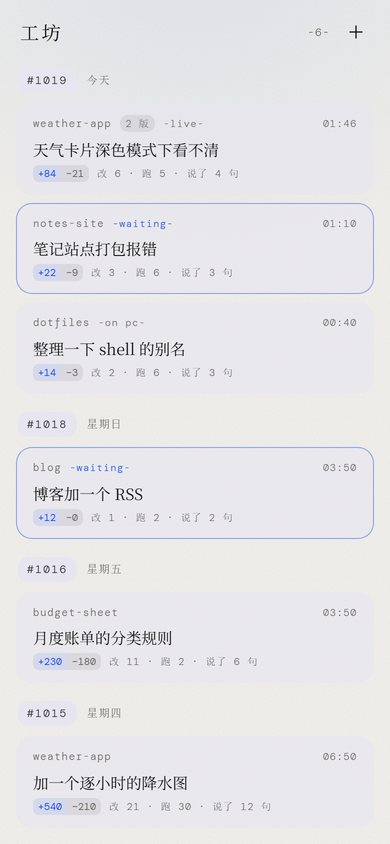
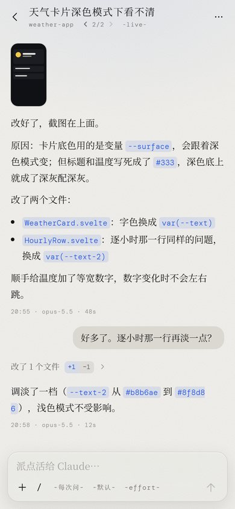
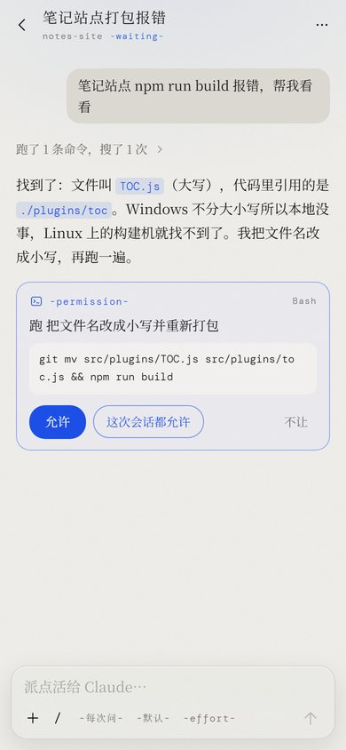
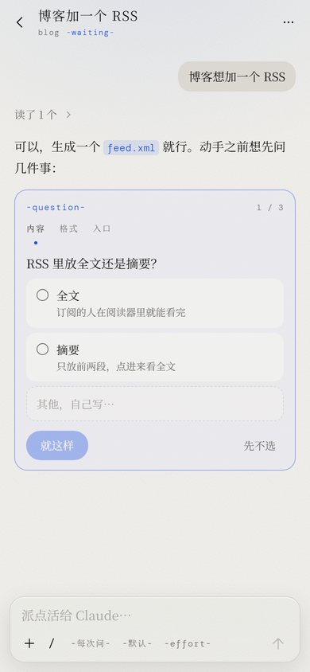

# 工坊 · Gongfang

在手机上看、接着用电脑上的 Claude Code 会话。

电脑上开着 cc 干活，人走开了也能在手机上看它做到哪、替它点"允许"、回答它的选择题、接着派活。像官方的 Remote Control，但整套跑在你自己的电脑上：一个零依赖的 Node 服务，加一个手机浏览器打开就能用的网页。

<p>
  
  
  
  
</p>

<sub>截图里的会话全是假后端（`pnpm mock`）编出来的。</sub>

[English](#english)

## 能做什么

- **看所有会话**：这台电脑上 `~/.claude/projects` 里的 cc 会话，按天分组，新的在上。在干活的、等你点头的、电脑上正开着的一眼看得出来。
- **接着说**：点开任何一个会话接着发话，发图也行。没在跑的会话会用 `--resume` 拉起来，cwd 用会话原来的目录。
- **新开会话**：右上角加号，挑一个用过的目录（或者手填路径）让它开工。
- **替它点头**：要跑命令、改文件时停下来等你：允许 / 这次会话都允许 / 不让（可以带一句话）。`AskUserQuestion` 的选择题、只出方案模式的方案，都能在手机上答。
- **看它干了什么**：一串工具调用收成一行"改了 3 个文件，跑了 2 条命令 +13 −7"，点开是每一步：改动对比带行号、命令和输出、读到的图。
- **换档不重开**：权限模式（每次问 / 自动 / 改文件不问 / 只出方案）、模型、effort，下一句生效，进程不重启。
- **斜杠命令**：输入框打 `/` 浮出这个目录能用的全部命令（内置 + 你装的 skill + 插件），`/compact`、`/context`、`/usage` 的输出排成卡片。
- **复制**：代码块带语言名和复制按钮，超过 5 行先折起来、点一下原地展开；每轮回复结尾一键复制整轮，或者摊到一张静止的全屏纸上随便划选（会话页里内容一直在变，跨屏划选容易断）。
- **停下**：随时停下这一轮；也能关掉后台进程（记录留着）。
- **不和电脑抢**：电脑上正开着的会话（2 分钟内有别的进程在写），手机上接着说会分出一条新会话，不两边写同一个文件。分出来的和原来那条在列表里并成一张卡片，会话页顶上 ‹ 1/2 › 切。

## 要什么

- **Node.js 20+**
- **Claude Code** 装好并登录过（订阅或 API key 都行）。在 Claude Code 2.1.x 上测过。
- pnpm（或 npm）
- 手机和电脑在同一个局域网，或者都装了 [Tailscale](https://tailscale.com/)（在外面也能连，推荐）

Windows 上主要用过。macOS / Linux 理论上可以（进程树按进程组杀），没有大量测过，欢迎反馈。

## 开始

```bash
git clone <这个仓库> gongfang
cd gongfang
pnpm install
pnpm build
pnpm start
```

Windows 也可以直接双击 `start.bat`（第一次会自动安装、打包）。

启动后会打印几个带钥匙的地址：

```
  工坊 1.0.0 开着了

  http://127.0.0.1:4800/?token=xxxxxxxx
  http://192.168.1.10:4800/?token=xxxxxxxx
  http://100.101.102.103:4800/?token=xxxxxxxx
```

在手机上打开和电脑同一个网络的那个地址就行。钥匙会存在手机浏览器里，并从地址栏里抹掉。之后再打开不带钥匙的地址也能直接进。想要像 app 一样用，就在浏览器菜单里选"添加到主屏幕"。

第一次启动时，如果没有 `config.json`，会自动生成一份，里面带一串随机钥匙。第一次列会话要把所有会话记录扫一遍建索引（会话多的话要十几秒），之后就快了。

## 配置

`config.json`（样例见 `config.example.json`，路径用正斜杠）：

| 项 | 默认 | 说明 |
|---|---|---|
| `host` | `"0.0.0.0"` | 监听地址。只在本机用就写 `"127.0.0.1"` |
| `port` | `4800` | 端口 |
| `token` | 自动生成 | 钥匙。留空的话启动时生成一串并写回 |
| `claude.exe` | `"claude"` | Claude Code 可执行文件。只写名字就在 PATH 里找；Windows 上 npm 装的 `claude.cmd` 会自动顺到包里的 `claude.exe`。找不到时启动会提示，这里写完整路径就行 |
| `claude.thinking_display` | `"summarized"` | 思考怎么显示。不传的话 `-p` 里的思考是空的 |
| `claude.models` | Opus / Sonnet / Haiku | 手机上模型菜单里的选项，`id` 原样传给 `--model`（别名、完整模型名都行）。"默认"那一项总在最前面，等于不传 |
| `hide` | `[]` | 这些目录里**起头**的会话不出现在任何地方（列表、记录、新开会话的目录），也不许在这些目录里新开会话。放私人项目用 |
| `hide_temp` | `true` | 系统临时目录里的会话（各种脚本、探针起的）也藏起来 |
| `data_dir` | `"./data"` | 索引和图片缓存放哪。都是缓存，随时可以删 |
| `max_live` | `4` | 最多同时挂几个 cc 进程。满了会先关掉最久没动的空闲进程 |
| `idle_minutes` | `20` | 进程空闲多久自动关（有后台命令在跑就不关） |

## 安全

工坊能让 cc 在这台电脑上改文件、跑命令，**钥匙就等于这台电脑的操作权限**：

- 别把钥匙发给别人，别把端口映射到公网。要在外面用，走 Tailscale 这类私有网络。
- 钥匙对不上一律 401。比对用的是 `timingSafeEqual`。
- 图片和事件流的请求带不了请求头，钥匙放在查询参数里，所以别把带钥匙的地址贴到别处。
- 权限请求默认"每次问"。"这次会话都允许"只在这个进程里生效，不会写进你的设置文件。

## 怎么做到的

- **会话列表**：直接读 cc 自己的会话记录 `~/.claude/projects/<目录>/<会话>.jsonl`（只读顶层文件，子文件夹里是子代理的日志）。每份抽一条摘要（标题、目录、改了几个文件、跑了几条命令……）缓存到 `data/term-index.json`，文件变长了只读新增的那一截。
- **接着说**：每个会话一个常驻进程：
  ```
  claude -p --input-format stream-json --output-format stream-json --verbose --include-partial-messages
         --permission-prompts host --permission-prompt-tool stdio --permission-mode <模式>
         --thinking-display summarized [--model …] [--effort …] (--session-id 新 | --resume 旧)
  ```
  一轮写一行 user 消息。stdout 的流式事件归一成"追加一条 / 改一条 / 往一条里追加字"三种，从 `/term/events`（SSE）推给手机。
- **权限**：cc 要问的时候在 stdout 发一个 `control_request`（`can_use_tool`），手机回了再写一个 `control_response` 回去。换模型、换模式、换 effort 也是控制请求（`set_model` / `set_permission_mode` / `apply_flag_settings`），不用重启进程。
- **斜杠命令清单**：起一个不说话的 cc，只发一句 `initialize`，回包里就有这个目录能用的全部命令。不走 API、不留会话文件，按目录缓存 10 分钟。

数据形状和全部接口写在 [`web/src/lib/term.ts`](web/src/lib/term.ts)。

## 踩过的坑

- **手机上点不了"允许"、选项一出来就被拒**：先看你的 `~/.claude/settings.json` 里有没有 `PermissionRequest` 钩子（一些桌宠、通知工具会装）。钩子和手机是抢答，谁先回听谁的。钩子几毫秒就回，手机要几秒，所以请求还没到手机就被钩子拒了。在那个会话的 jsonl 里能看到 `hook_permission_decision`。关掉那个工具的权限功能就好。
- **自动模式没生效**：自动模式要看模型，haiku 用不了。cc 不报错，悄悄按"每次问"起，工坊会在记录里插一行提示。
- **`/clear` 不在清单里**：它会换掉会话 id，工坊跟不上，所以藏了。要清空就新开一个会话。
- **一直回 "Prompt is too long"**：这个会话的上下文满了。新开一个会话接着做。
- **电脑上开着、但闲了 2 分钟以上的会话**：手机上接着说会和电脑同时写一个文件（官方 Remote Control 也一样）。要么电脑上先关掉，要么就当它是分叉。
- **后端重启**：挂着的 cc 进程会跟着退出（stdin 断了），记录都在。在手机上再说一句就会 `--resume` 回来。
- **这些参数不是公开文档里的**：`--permission-prompts host`、控制请求的格式都是从 cc 的行为里摸出来的，cc 升级可能会变。哪天坏了，先看后端打印的 stderr 和记录里"cc 进程退出了"那一行。

## 开发

```bash
pnpm mock        # 假后端：不碰 claude、不读你的会话，全是编的。http://127.0.0.1:4800/?token=demo（先 pnpm build）
pnpm dev         # 前端热更新，http://localhost:5180 ，默认连 127.0.0.1:4800
pnpm check       # 类型检查
```

在假后端里发一句话会模拟一轮：想 → 读 → 改 → 打包 → 等你点头 → 收尾。话里带"选项"出选择题，带"方案"出方案。

```
server/
  index.mjs      HTTP 服务：静态页面、钥匙、/api/hello、/term/* 交给 term.mjs
  term.mjs       全部的活：索引、记录解析、常驻进程、权限、事件流
  config.mjs     读 config.json、找 claude
web/src/
  lib/term.ts    数据形状 + 接口表（前端、后端、假后端共用）
  lib/term.svelte.ts   前端状态：会话列表、打开着的会话、事件流
  screens/       首页（会话列表）、会话页、连接页
  components/    权限卡片、工具抽屉、改动对比、斜杠命令清单……
tools/mock-server.mjs  假后端
```

前端是 Svelte 5 + Vite，打包后由后端托管，后端运行时没有任何 npm 依赖。

## License

MIT

---

## English

**Gongfang** (工坊, "workshop") lets you watch and continue your local Claude Code sessions from your phone, like the official Remote Control, but entirely self-hosted: a zero-dependency Node server plus a mobile web UI.

- Lists every session in `~/.claude/projects`, grouped by day; shows which ones are working, waiting for you, or open on the PC.
- Continue any session (text + images); idle ones are resumed with `--resume` in their original cwd. Start new sessions in any directory you've used.
- Answer permission prompts (allow / allow for this session / deny with a message), `AskUserQuestion` multiple choice, and plan approvals from the phone.
- Tool calls are summarized ("edited 3 files, ran 2 commands +13 −7") and expandable to diffs with line numbers, command output and images.
- Code blocks with copy / expand (folded after 5 lines); copy a whole reply or open it on a static full-screen page for easy text selection.
- Switch permission mode, model and effort without restarting the process. Slash-command palette with every command available in that directory.
- Won't fight your PC: if a session is being written by another process, continuing it from the phone forks a new session instead.

**Setup:** Node 20+, Claude Code installed and logged in, then `pnpm install && pnpm build && pnpm start` and open one of the printed `?token=` URLs on your phone (same LAN or Tailscale). Configuration lives in `config.json` (see the table above; `hide` lists directories whose sessions should never be shown).

**Security:** the token is effectively shell access to your computer. Don't share it and don't expose the port to the internet.

**How:** one long-lived `claude -p --input-format stream-json --output-format stream-json --permission-prompt-tool stdio …` process per session; permission prompts arrive as `control_request` on stdout and are answered with `control_response`. Some of these flags are undocumented and may change between Claude Code versions (tested on 2.1.x). The UI is Chinese-only for now.
